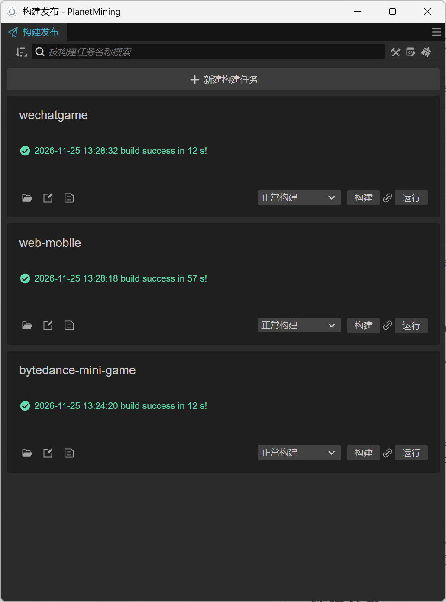

# cocos-legacy-build

Cocos Creator 3.8.x 编辑器扩展：找回经典「构建发布」面板（builder.old），并把构建进度条修好。



## 背景

从 Cocos Creator 3.8.x 起，默认构建入口换成了新版构建页（builder-ui），经典构建面板从菜单里消失了——但安装包里其实还保留着（panel id = `builder.old`）。而且 3.8.x 的分栏（Shadow DOM）架构下，即使打开经典面板，构建进度条也显示不出来。

本扩展做两件事：

1. **找回入口**：在「项目」菜单增加「打开旧版构建发布」，一键打开内置的 `builder.old` 经典面板；
2. **修好进度**：把构建进度实时画回这个面板里，不新开窗口。

## 环境要求

- Cocos Creator **>= 3.8.0**（在 **3.8.8** 上开发与实测）

## 安装

**项目级**（仅当前项目生效）：把本仓库克隆 / 下载到项目的 `extensions/` 文件夹下：

```
你的项目/
└── extensions/
    └── cocos-legacy-build/
        ├── package.json
        └── main.js
```

**全局**（所有项目生效）：放到编辑器版本目录 `~/.CocosCreator/builtin-extensions/<编辑器版本>/cocos-legacy-build/`（Windows 即 `C:\Users\<用户名>\.CocosCreator\builtin-extensions\<编辑器版本>\cocos-legacy-build\`），编辑器会把它当作内置扩展直接加载（本扩展开发时即采用此方式）。

> 注：Cocos Creator 3.7 起，`~/.CocosCreator/extensions/` 用户级全局扩展目录已不再自动加载，放这里不会生效。

安装后重启编辑器（或刷新扩展）即可。

## 使用

菜单栏：**项目 → 打开旧版构建发布**

构建时，进度会直接画在经典面板的任务卡片里。

## 卸载

删除本扩展文件夹即可完全还原：既不再注入进度，也不多出菜单项。

## License

[MIT](LICENSE)
